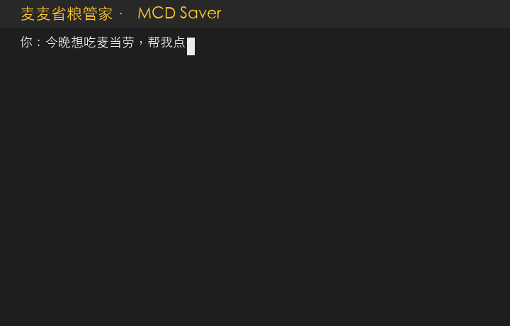

<h1 align="center">
  🍔 麦麦省粮管家
  <br>
  <sub>一个「会点餐」的麦当劳 AI Skill</sub>
</h1>

<p align="center">
  <b>先懂你想吃什么，再帮你省钱 —— 省钱是约束，不是目标。</b>
</p>

<p align="center">
  <a href="#-一句话">简介</a> ·
  <a href="#-它能做什么">能力</a> ·
  <a href="#-快速开始">快速开始</a> ·
  <a href="#-核心亮点">亮点</a> ·
  <a href="#-关键技术发现">技术发现</a>
</p>

<p align="center">
  
  
  
  
</p>

<p align="center">
  
</p>

<p align="center">
  <em>麦当劳中国 × WorkBuddy「1024 程序员节创意开发大赛」参赛作品</em>
</p>

---

## 🎯 一句话

报个意图（健康 / 解馋 / 换口味 / 省钱 / 随便），它先问你「为什么点这一顿」，再按当前时段、套餐搭配、真实优惠，帮你点出**合理又划算**的一餐。

> 别的省钱助手只会算「怎么最便宜」；麦麦省粮管家先懂「你为什么点」。
>
> 上面的 GIF 正是本项目的诞生理由：裸算法会推荐「晚上的一杯咖啡 + 套餐」，体验层把它纠正成「刚好的一顿」。

## 🚀 快速开始

```bash
git clone <你的仓库地址>
cd mcd-saver
python3 src/demo.py   # 一行命令看完整链路，无需 MCP Token
```

## 🍟 它能做什么

| 场景 | 你的输入 | 它的输出 |
|---|---|---|
| 🧭 意图推荐 | 「今晚想吃点好的」 | 先问意图，按时段+口味推荐合理搭配 |
| 💰 省钱 | 「预算 35 元，帮我省钱」 | 促销价 + 特价券最优组合（守时段/去重） |
| 🥗 健康 | 「800 大卡以内、高蛋白」 | 满足营养约束的搭配 |
| 🎫 领券 | 「帮我领券」 | 一键领满麦麦省全部可用券 |
| 📍 找店 | 「附近哪家麦麦」 | 附近门店 + 该店可用券 |

## ✨ 核心亮点

技术深度在两层：**「会算」**（组合优化）+ **「会点」**（体验规则）。

### 会算 —— 真实省钱额驱动的组合优化

- **多价格档位建模**：每个餐品有多个候选价（无券现价 + 券后价），券是「指定商品特价券」，把特定商品压到券后价；算法遍历「商品 × 价格档位」组合
- **真实省钱额**：以 `calculate-price` 的 `discount` 字段为准，而非菜单划线价差
- **top-K + 精排**：启发式初筛出 top-K 候选，再逐个调真实报价精排，避免「启发式误判」
- **多目标**：`max_saving`（省钱最多）/ `min_pay`（实付最低），支持预算、热量、蛋白约束

### 会点 —— 点餐意图前置层

- **意图前置**：先问「健康 / 解馋 / 换口味 / 省钱 / 随便」，带意图推荐
- **时段适配**：晚餐/夜宵不推咖啡、早餐类
- **套餐去重**：套餐已含可乐，就不再额外推咖啡/饮料
- **凑单保护**：为凑券而加购、净支出上升的组合视为负优化

## 🔍 关键技术发现

实测麦当劳 MCP 数据，澄清了「省钱到底省在哪」：

| 认知误区 | 真实情况 |
|---|---|
| 省钱靠满减券叠加 | 券是「指定商品特价券」，绑定特定 productCode，把商品压到券后价 |
| 菜单划线价 = 省下的钱 | 划线价是营销标注；真实省钱额在 `calculate-price` 的 `discount`（如「大堡口福三件套」划线价 ¥47，但真实 discount=0） |
| 价格单位是元 | `calculate-price` 金额单位是「分」，需 /100 转元 |

这些发现驱动了整个算法设计——**不信划线价，一切以结算接口的真实 discount 为准**。

## 📁 项目结构

```
mcd-saver/
├── SKILL.md              # Skill 定义（意图前置 + 四阶段流程）
├── README.md
├── LICENSE
├── data/nutrition.tsv    # 营养数据（list-nutrition-foods 实测，158 条）
├── docs/
│   ├── dev-log.md        # 完整开发记录（含两轮对抗式审查）
│   └── submit-issue.md   # 参赛 Issue 提交文案
└── src/
    ├── optimizer.py      # 组合优化（多价格档位 + top-K 精排）
    ├── mcp_adapter.py    # MCP 数据映射 + 营养回填 + 报价解析
    ├── taste.py          # 点餐意图与体验规则（时段/去重/凑单保护）
    ├── run.py            # 编排层：意图 → 过滤 → 优化 → 精排 → 下单
    └── demo.py           # 端到端离线演示
tools/
└── make_gif.py           # 生成 README 演示 GIF（Pillow）
```

## 🔌 依赖的 MCP 能力

`auto-bind-coupons` · `query-nearby-stores` · `query-store-coupons` · `query-meals` · `query-meal-detail` · `list-nutrition-foods` · `calculate-price` · `create-order` · `available-coupons`

## 🏆 参赛声明

本项目为麦当劳中国「1024 程序员节创意开发大赛」参赛作品，基于麦当劳 MCP 能力平台开发，使用腾讯 WorkBuddy 完成。开发过程（含两轮对抗式审查）完整记录见 `docs/dev-log.md`。

## 📄 License

MIT
